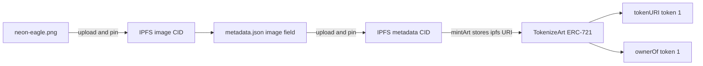
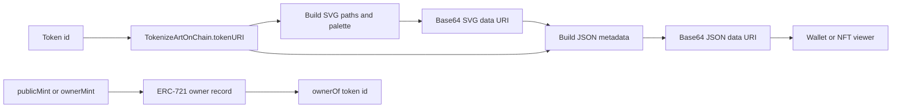

# Architecture

## Mandatory IPFS collection

The token points to metadata. The metadata points to the image. `ownerOf` is read directly from the contract and does not depend on IPFS.

## On-chain bonus

## Contract components

- `TokenizeArt` inherits OpenZeppelin `ERC721URIStorage` and `Ownable`. `mintArt` checks the recipient, URI and cap, records the counter and token URI, then checks the receiver hook.
- `TokenizeArtOnChain` inherits OpenZeppelin `ERC721` and `Ownable`. It tracks total minted and one public mint per address. `tokenURI` creates JSON and SVG bytes on demand, then Base64-encodes them.
- OpenZeppelin `ERC721Utils` checks safe-mint recipients. Mint state is established before the callback; a callback failure reverts the whole transaction.
- `NonReceiver.sol` is a local test fixture used only to prove safe mint rejection. It is not used by either NFT contract.
- Hardhat configuration and packages live in `deployment/`. Because Hardhat 2 requires the source tree under its root, `prepare-contracts.js` copies canonical code and tests into ignored build folders before the tasks run.

## Mint sequence

The required mint sequence is: upload image, write the image CID to metadata, upload metadata, deploy the contract, mint the metadata URI, and read both `tokenURI` and `ownerOf`. The optional website calls `publicMint` on the separate on-chain contract and then decodes its returned data URI in the browser.
